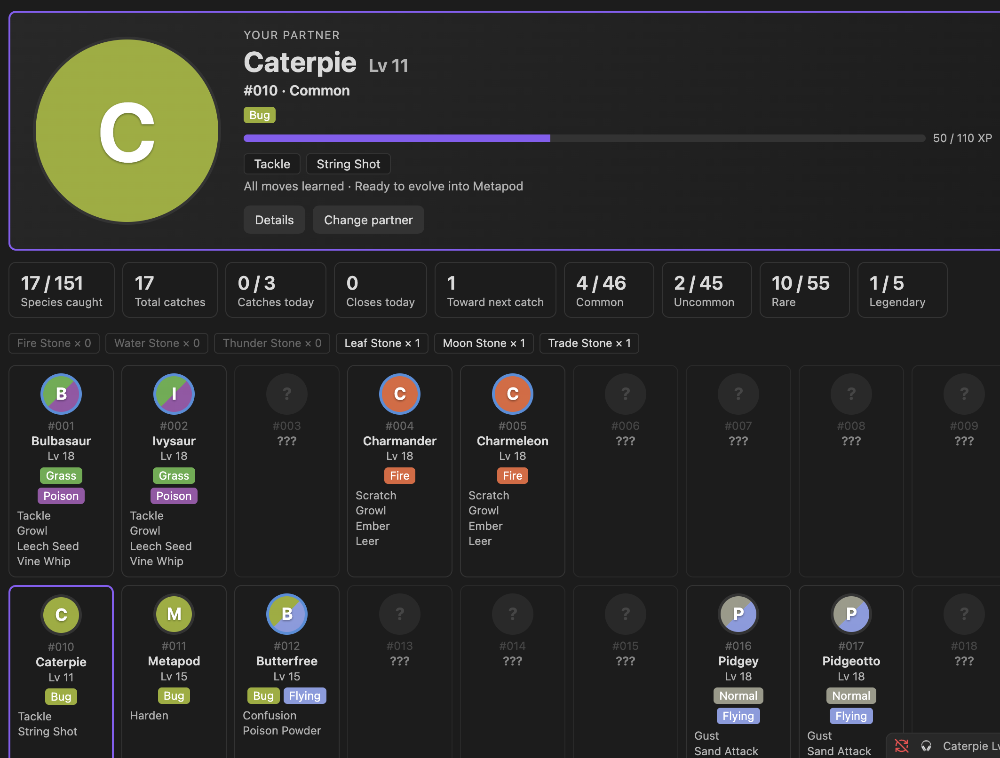
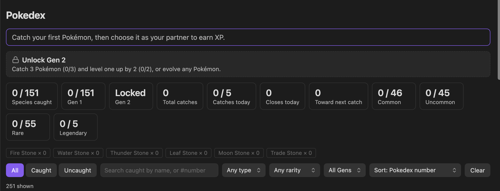
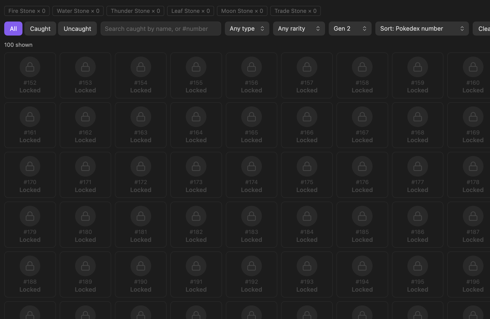

# Sheiko Pokedex

An Obsidian plugin that turns finishing tasks into catching Pokémon. Close tasks in [TaskNotes](https://github.com/callumalpass/tasknotes) and catch a random Pokémon every 4–7 closes; the more you close in a day, the better your odds. Pick a partner, level it up from your work, evolve it, and fill your Pokedex. Gen 1 is open from the start; **Gen 2 unlocks as you play**.



> **Unofficial fan project.** Not affiliated with, endorsed by, or sponsored by Nintendo, Game Freak, Creatures Inc. or The Pokémon Company. Pokémon and Pokémon names are trademarks of their respective owners. **This repository contains no Pokémon artwork.** Every Pokémon is drawn as a coloured placeholder badge unless you download sprites yourself (see [Sprites](#sprites-optional)).

- **New here?** The [user guide](docs/USER-GUIDE.md) walks through what you'll see, with screenshots.
- **Want the exact rules?** [How it works](docs/HOW-IT-WORKS.md) has the odds, XP, limits and timing.

## Contents

- [Requirements](#requirements) · [Install](#install)
- [Catching](#catching) · [Browsing the Pokedex](#browsing-the-pokedex) · [Generations](#generations)
- [Partner and evolution](#partner-and-evolution) · [Stones and Trade Items](#stones-and-trade-items) · [Starter pack](#starter-pack)
- [Sprites](#sprites-optional) · [Privacy](#privacy)
- [Data](#data) · [Development](#development) · [Known limits](#known-limits) · [Support](#support)
- [Credits and licence](#credits-and-licence) · [Third-party notices](#third-party-notices)

## Requirements

- Obsidian desktop **1.13 or later** (desktop only). The plugin's settings show up in Obsidian's settings search.
- [TaskNotes](https://github.com/callumalpass/tasknotes), enabled
- [Sheiko Task Lifecycle](https://github.com/Ashura-Sheikh/Sheiko-obsidian-plugin), enabled

## Install

**From Obsidian (recommended).** Sheiko Pokedex is in the Obsidian community directory ([listing](https://community.obsidian.md/plugins/sheiko-pokedex)).

1. Go to **Settings → Community plugins** and turn off Restricted mode if it's on.
2. Select **Browse**, search for **Sheiko Pokedex**, then **Install** and **Enable**.
3. Install and enable TaskNotes and Sheiko Task Lifecycle the same way if you haven't already.

**From a release.** Download `main.js`, `manifest.json` and `styles.css` from the [latest release](https://github.com/Ashura-Sheikh/Sheiko-pokedex-plugin/releases/latest) into `<your vault>/.obsidian/plugins/sheiko-pokedex/`. Then refresh the list in **Settings → Community plugins** and enable **Sheiko Pokedex**.


**From source.** You need [Node.js](https://nodejs.org/).

```
git clone https://github.com/Ashura-Sheikh/Sheiko-pokedex-plugin.git
cd Sheiko-pokedex-plugin
npm install
npm run build
```

Then copy the same 3 files into the plugin folder and enable it as above.

**If your vault is in git,** add `.obsidian/plugins/sheiko-pokedex/` to its `.gitignore` to keep your catch data out of your vault's history.

## Catching

- **Close a task, make progress.** Each counted close made while Obsidian is running moves you toward the next catch. The target is a hidden number from 4 to 7. Tasks that were already done when the plugin starts never count.
- **Better closes, better odds.** High-priority tasks and tasks closed within their SLA target score higher, and so does closing more in a day. A higher score raises the odds of Uncommon, Rare and Legendary Pokémon. Task `contexts` narrow which types can appear; the mapping is editable in the settings.
- **Not every close counts.** A task counts once, even after a reopen, rename or archive move. Tasks closed with `closeReason: superseded` or `parked` don't count. Very large bursts of closes count for less.
- **Daily catch limit** (default 5, a setting). Closes after the limit give your partner XP only.
- **Updating from 1.3.0 or earlier with a limit of 3:** your limit stays 3 until you choose. A notice says the default is now 5, and **Settings → Sheiko Pokedex** shows **Move to 5** and **Keep 3** until you pick one or type a new limit. Any other limit you set is kept and you aren't asked.

Scores, odds and bulk-close rules: [How it works → Catching](docs/HOW-IT-WORKS.md#catching).

## Browsing the Pokedex

A toolbar above the grid:

- **All · Caught · Uncaught:** which Pokémon to show. The view opens on **All**.
- **Search** (case-insensitive): part of a caught Pokémon's name, or a Pokedex number (`25`, `025` or `#025`).
- **Gen**, **Type** and **Rarity** filters, each with *Any*. The view shows a count per Gen.
- **Sort:** Pokedex number (default), name, level (highest first), catches (most first), or **date added** (newest or oldest first). Date added includes evolving and the Starter pack.
- **Clear:** back to All, no search, any type, any rarity, Pokedex number.
- **Empty states:** with nothing caught, Caught offers **Show all Pokémon**; when nothing matches, **Clear filters**.

**No spoilers.** A name search only matches caught Pokémon. With a type or rarity filter on, only caught Pokémon are shown, even when searching by number. With any sort other than number, caught Pokémon come first and the **???** cards follow in Pokedex order. So nothing reveals a Pokémon you haven't caught.

Toolbar settings last while the view is open, including when it refreshes after a catch. They're never saved, and browsing never changes your data.

## Generations

**Gen 1** (#1–151) is open from the start. **Gen 2** (#152–251, 100 Pokémon, including Raikou, Entei, Suicune, Lugia, Ho-Oh and Celebi) **unlocks when you catch 3 Pokémon and level one Pokémon up by 2 levels, or evolve any Pokémon.**

- **Before it unlocks,** Gen 2's cards show as **locked** (a number, a lock and "Locked", nothing else), and a panel above the grid shows your progress. A locked Gen shows "Locked" in the Gen count.
- **When it unlocks,** a notice says so. Gen 2 Pokémon can be caught, and the new evolutions and items open.
- **Updating from 1.x:** if you already meet the rule, Gen 2 unlocks straight away.
- **Gen 1 gains with the unlock:**
  - **8 baby forms:** Pikachu (Pichu), Clefairy (Cleffa), Jigglypuff (Igglybuff), Hitmonlee and Hitmonchan (Tyrogue), Jynx (Smoochum), Electabuzz (Elekid), Magmar (Magby).
  - **10 evolutions:** Golbat → Crobat, Eevee → Espeon and Umbreon, Chansey → Blissey, Gloom → Bellossom, Poliwhirl → Politoed, Slowpoke → Slowking, Onix → Steelix, Scyther → Scizor, Seadra → Kingdra, Porygon → Porygon2.
- **Coming next:** more Gens, one at a time, each unlocked the same way. No dates.





Unlock details and the Gen 1 trade-off: [How it works → Unlocking Gens](docs/HOW-IT-WORKS.md#unlocking-gens).

## Partner and evolution

- **Choose a partner** from your caught Pokémon: **Choose partner** in the Pokedex view, **Make partner** on a Pokémon, or the **Choose partner** command. **You need a partner to earn XP:** closes before you choose one earn none.
- **Partner card:** a large card at the top of the Pokedex view with a 2× sprite, level and XP bar, current moves, next move and what it evolves into (level, stone or fully evolved).
- **Partner animation:** hovering over the card, or tabbing into it, plays a short animation. Choose in **Settings → Sheiko Pokedex → Partner animation**:
  - **Calm** (default): a soft glow in the partner's type colour.
  - **Full:** a single movement (a bounce, shake, float…) with a small CSS effect for its main type: flames for Fire, a splash for Water, sparks for Electric, leaves for Grass, frost for Ice, and so on for every type. No images, no downloads.
  - **Off:** nothing.

  Thanks to @DiditaDeliaAndreea for the idea (#31).
- **Status bar:** shows the partner and its level, e.g. "Charmeleon Lv 17".
  - **Hover:** XP (e.g. "140 / 170 XP") and whether an evolution is available.
  - **Click:** opens the Pokedex, or the partner picker if no partner is set yet.
  - **Right-click:** Open Pokedex, Choose partner and, once the partner has reached its evolution level (including after a Cancel), **Evolve now**.
- **XP and levels:** every counted close, and every close over the daily limit, gives your partner XP, more for bigger tasks; a duplicate catch adds a bonus. Each Pokémon keeps its own level (from 5, up to 100), so swapping partners loses nothing.
- **Moves:** Red/Blue level-up moves for Gen 1, X/Y for Gen 2. Each card lists the moves it knows now; the detail window shows the full list with levels and the next move. The XP notice and the reward window say "Learned Ember!" on a level-up.
- **Evolution:** at its evolution level, the partner's **Evolution scene** plays: "What? CHARMELEON is evolving!" on an original green screen, with Red/Blue's timing. **Press B** (or **Stop**, or close the window) to stop it; you're asked again at the next level. The evolved form keeps the level and becomes the partner, and **both forms stay caught**. The **Calm evolution scene** setting replaces the flicker with a slow fade.

XP formula, level costs and scene timing: [How it works](docs/HOW-IT-WORKS.md#partner-xp-and-levels).

## Stones and Trade Items

**Stones:** 1 in 25 catches also finds a stone matching the caught Pokémon's type:

| Caught type | Stone |
|---|---|
| Fire | Fire Stone |
| Water, Ice | Water Stone |
| Electric | Thunder Stone |
| Grass | Leaf Stone; with Gen 2 unlocked, a Leaf or a **Sun Stone** at random |
| Bug | Leaf Stone |
| Fairy, Normal, Poison | Moon Stone |
| Psychic, Fighting, Rock, Ground, Ghost | Trade Stone |
| anything else | a random one of the unlocked Gens |

**Trade Items** (with Gen 2 unlocked) are for evolutions that aren't by level or stone. They're found as your partner levels up and as you close tasks; your **partner's** primary type decides which one:

| Partner's type | Trade Item | Used for |
|---|---|---|
| Water, Psychic | King's Rock | Politoed, Slowking |
| Steel, Bug, Rock, Ground | Metal Coat | Steelix, Scizor |
| Dragon, Ice | Dragon Scale | Kingdra |
| Electric | Up-Grade | Porygon2 |
| Normal, Fairy, Poison, Flying | Friendship Charm | Pichu, Cleffa, Igglybuff, Togepi, Golbat, Chansey, Eevee (Espeon, Umbreon) |
| Fighting, Fire, Grass, Ghost, Dark | Trade Item | Tyrogue (Hitmonlee, Hitmonchan, Hitmontop) |

**To use one,** click the Pokémon in the Pokedex and choose it. The **Trade Stone** stands in for plain trade evolutions (Kadabra, Machoke, Graveler, Haunter). Eevee's form depends on the stone (Water, Thunder or Fire), or the Friendship Charm with Gen 2 unlocked (Espeon or Umbreon, your choice).

Drop odds: [How it works → Stones and Trade Items](docs/HOW-IT-WORKS.md#stones-and-trade-items).

## Starter pack

A one-time boost per install, in **Settings → Sheiko Pokedex → Starter pack** or as commands:

- **One of each stone:** a Fire, Water, Thunder, Leaf, Moon and Trade Stone (no Sun Stone and no Trade Items).
- **Choose a Pokémon:** any Gen 1 Pokémon you haven't caught yet, legendaries included. It joins at level 5 and counts in your Pokedex, but not as a close or a catch. It's marked as from the Starter pack in the plugin's data.
- **500 XP for your partner, 3 times:** each use goes to whoever is your partner at the time, so you can split or stack them. About 3 uses take a level-5 Charmander to 16. With no partner, or a partner at level 100, nothing is used up.

You're asked to confirm before anything is used. Once a part is used it's gone for this install: updates, reloads and setting changes never refill it. Commands for used-up parts disappear from the command list.

## Sprites (optional)

Until you download sprites, every Pokémon is a coloured placeholder badge. Unseen Pokémon show as black silhouettes; **locked** ones show a lock, never their sprite.

To see the classic 96×96 pixel sprites, go to **Settings → Sheiko Pokedex → Sprites** and press a **Download** button. Each group has its own: **Gen 1** (151) and **Gens 2–4** (100 now; Gens 3 and 4 join it when they're released). A button fetches only the sprites you don't have yet, so it can be pressed again after an update.

- **Off by default.** Nothing is downloaded until you press a button.
- **Checked:** each image must be a valid PNG of the right size, and nothing is saved unless the whole group passes. Download details: [How it works → Sprite download](docs/HOW-IT-WORKS.md#sprite-download).
- **Saved locally** in the plugin's `sprites/` folder, with its own `.gitignore`.
- **To go back to badges,** press **Remove sprites** in the same place. That deletes the folder.
- **Who owns them:** the artwork belongs to Nintendo / Game Freak. It is not covered by this plugin's licence or PokeAPI's. **Sprites are for your own use: don't commit, share or redistribute them.**

**This repository and its releases never contain Pokémon artwork, and tests enforce it.** CI fails if an image file is committed anywhere except as a PNG in `docs/images/`, if any committed PNG is 96×96 (a sprite's size), or if embedded image data is committed. The release workflow fails if `main.js` contains image data. The screenshots in `docs/images/` contain no sprites.

## Privacy

- **It never writes to your notes.** It reads each task's frontmatter after Sheiko has finished; all Pokedex state is kept in the plugin's own `data.json`.
- **The sprite download is the only network request,** and only when you press the button.
- **Vault enumeration:** at startup the plugin reads every Markdown file's frontmatter from Obsidian's cache once, to know which tasks were already done (TaskNotes can mark a note as a task anywhere). That's what the Community directory's scan reports. Nothing is written or sent anywhere.

## Data

`src/data/pokedex.ts` is generated from [PokeAPI's CSV data](https://github.com/PokeAPI/pokeapi/tree/master/data/v2/csv) by `scripts/build_species_data.py`. It holds names, types, capture rates, each species' Gen, evolution links (with each stone or Trade Item) and level-up moves: Red/Blue for #1–151 (989 after removing repeats) and X/Y for #152–251 (1,476). No images.

- **Tiers** (#1–251): legendary/mythical (11); then by capture rate: ≤ 45 rare (95), ≤ 120 uncommon (76), otherwise common (69).
- **Evolution methods:** level, a stone, a plain trade (the Trade Stone), or a Trade Item. A trade while holding an item uses that item; friendship, affection and beauty use the Friendship Charm; every other condition (stats, time of day, gender …) uses the general Trade Item.
- **Types** are PokeAPI's current ones, so Clefairy is Fairy and Magnemite is Electric/Steel.

To regenerate (needs `pokemon_species`, `pokemon_species_names`, `pokemon_types`, `types`, `pokemon_evolution`, `items`, `pokemon_moves`, `move_names` and `moves` CSVs):

```
python3 -I scripts/build_species_data.py <folder with the CSV files>
```

## Development

```
npm install
npm run build   # type-check + bundle to main.js (the release build)
npm run dev     # development build, rebuilds on change; includes the test tools below
npm test        # Node's built-in test runner, obsidian mocked; no network, no real images
npm run lint
```

- **Test tools (development builds only):** a `npm run dev` build adds a **Test tools** setting with unlimited commands: give the partner 500 XP, give one of each stone and Trade Item, and add any Pokémon. Release builds (`npm run build`, which the release workflow uses) don't contain them, and a test builds the release bundle and checks.
- **CI:** `.github/workflows/ci.yml` runs build, lint and test on Node 20, 22 and 24 for every pull request into `main` and every push to `main`.
- **Releases:** pushing a version tag (e.g. `1.0.1`) runs `.github/workflows/release.yml`. It checks the tag matches `manifest.json`, builds and tests, **fails if `main.js` contains any image data**, and creates a draft release titled `v<tag>` with the 3 files. Runs for the same tag queue one at a time, and no second draft is made if a release for the tag already exists. Build provenance is added once the repo is public. Each release's notes are on its GitHub release page.
- If you open the repo folder itself as an Obsidian test vault, its `.obsidian/`, `TaskNotes/` and screenshot folders are git-ignored.

## Known limits

- **Only live closes count.** A close made while Obsidian is closed, or synced in from another device, isn't seen.
- **The SLA targets are fixed** in `src/rarity.ts`. They aren't read from your vault.
- **The Starter pack is once per install, not once per person.** It's tracked in the plugin's `data.json`, alongside your Pokedex. A fresh `data.json` starts with a full pack, and with an empty Pokedex.
- **The Sheiko check uses an internal Obsidian API.** It reads `app.plugins.enabledPlugins`, which isn't part of the documented API.

## Support

Best effort, no response-time guarantee. Report issues on [GitHub](https://github.com/Ashura-Sheikh/Sheiko-pokedex-plugin/issues); see [CONTRIBUTING.md](CONTRIBUTING.md) for bug reports and pull requests. Developed against TaskNotes 4.13.8 and Sheiko Task Lifecycle 0.2.2.

## Credits and licence

- Pokémon data (names, types, evolutions, moves) comes from [PokeAPI](https://pokeapi.co/). The optional sprites are downloaded from [PokeAPI's sprite repository](https://github.com/PokeAPI/sprites).
- Built to work alongside [TaskNotes](https://github.com/callumalpass/tasknotes) and [Sheiko Task Lifecycle](https://github.com/Ashura-Sheikh/Sheiko-obsidian-plugin).
- **Licence:** [MIT](LICENSE), © 2026 Sheikh M Sahil. It covers this plugin's own code and documentation.
  - It doesn't cover Pokémon names, move names or other Pokémon content. Those belong to their owners and aren't licensed by this project.
  - It doesn't cover the PokeAPI-derived data, which comes under PokeAPI's own licence, reproduced under [Third-party notices](#third-party-notices).
  - It doesn't cover the sprites. Their artwork belongs to Nintendo / Game Freak; PokeAPI's sprite repository says so too ("All image contents within are Copyright The Pokémon Company"). The plugin never ships them; you download them for your own use.

## Third-party notices

`src/data/pokedex.ts`, and therefore `main.js`, contains data generated from [PokeAPI](https://github.com/PokeAPI/pokeapi)'s CSV files. PokeAPI's licence is reproduced below, as its second condition asks. The same notice sits at the end of every built `main.js`, so it reaches people who install from a release too.

```text
Copyright (c) © 2013–2023 Paul Hallett and PokéAPI contributors (https://github.com/PokeAPI/pokeapi#contributing). Pokémon and Pokémon character names are trademarks of Nintendo.

All rights reserved.

Redistribution and use in source and binary forms, with or without modification, are permitted provided that the following conditions are met:

* Redistributions of source code must retain the above copyright notice, this list of conditions and the following disclaimer.

* Redistributions in binary form must reproduce the above copyright notice, this list of conditions and the following disclaimer in the documentation and/or other materials provided with the distribution.

* Neither the name of PokéAPI nor the names of its contributors may be used to endorse or promote products derived from this software without specific prior written permission.

THIS SOFTWARE IS PROVIDED BY THE COPYRIGHT HOLDERS AND CONTRIBUTORS "AS IS" AND ANY EXPRESS OR IMPLIED WARRANTIES, INCLUDING, BUT NOT LIMITED TO, THE IMPLIED WARRANTIES OF MERCHANTABILITY AND FITNESS FOR A PARTICULAR PURPOSE ARE DISCLAIMED. IN NO EVENT SHALL THE COPYRIGHT HOLDER OR CONTRIBUTORS BE LIABLE FOR ANY DIRECT, INDIRECT, INCIDENTAL, SPECIAL, EXEMPLARY, OR CONSEQUENTIAL DAMAGES (INCLUDING, BUT NOT LIMITED TO, PROCUREMENT OF SUBSTITUTE GOODS OR SERVICES; LOSS OF USE, DATA, OR PROFITS; OR BUSINESS INTERRUPTION) HOWEVER CAUSED AND ON ANY THEORY OF LIABILITY, WHETHER IN CONTRACT, STRICT LIABILITY, OR TORT (INCLUDING NEGLIGENCE OR OTHERWISE) ARISING IN ANY WAY OUT OF THE USE OF THIS SOFTWARE, EVEN IF ADVISED OF THE POSSIBILITY OF SUCH DAMAGE.
```
