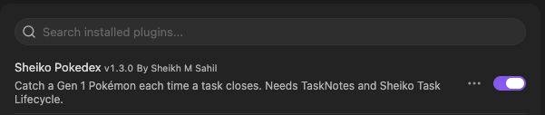

# Sheiko Pokedex

An Obsidian plugin that turns finishing tasks into catching Pokémon. Close tasks in [TaskNotes](https://github.com/callumalpass/tasknotes) and catch a random Gen 1 Pokémon every 4–7 closes; the more you close in a day, the better your odds. Pick a partner, level it up from your work, evolve it, and fill your Pokedex.

> **Unofficial fan project.** Not affiliated with, endorsed by, or sponsored by Nintendo, Game Freak, Creatures Inc. or The Pokémon Company. Pokémon and Pokémon names are trademarks of their respective owners. **This repository contains no Pokémon artwork.** By default every Pokémon is drawn as a coloured placeholder badge. Sprites are optional: you download them yourself from the plugin's settings (see [Sprites](#sprites-optional-downloaded-by-you)).

**New here?** The [user guide](docs/USER-GUIDE.md) walks through what you'll see, with screenshots: your first catch, the Pokedex, a Pokémon's details, the status bar, evolution and sprites.

## Requirements

- Obsidian desktop **1.13 or later** (the plugin is desktop only). Since 1.1.0 its settings use Obsidian 1.13's settings API, so they show up in Obsidian's settings search. 1.0.1 and earlier ran on Obsidian 1.4.4 and later.
- [TaskNotes](https://github.com/callumalpass/tasknotes), enabled
- [Sheiko Task Lifecycle](https://github.com/Ashura-Sheikh/Sheiko-obsidian-plugin), enabled

## Install

Sheiko Pokedex is in the Obsidian community directory ([listing](https://community.obsidian.md/plugins/sheiko-pokedex)). Installing from Obsidian is the easiest route; the two manual routes below still work.

### Option 1: from Obsidian (recommended)

1. In Obsidian, go to **Settings → Community plugins** and turn off Restricted mode if it's on.
2. Select **Browse**, search for **Sheiko Pokedex**, then select **Install** and **Enable**.

Install and enable [TaskNotes](https://github.com/callumalpass/tasknotes) and [Sheiko Task Lifecycle](https://github.com/Ashura-Sheikh/Sheiko-obsidian-plugin) the same way if you haven't already.

### Option 2: from a release (no tools needed)

1. Open the [latest release](https://github.com/Ashura-Sheikh/Sheiko-pokedex-plugin/releases/latest) and download `main.js`, `manifest.json` and `styles.css`.
2. Create the folder `<your vault>/.obsidian/plugins/sheiko-pokedex/` and put the 3 files in it.
3. In Obsidian, go to **Settings → Community plugins**, refresh the list, and enable **Sheiko Pokedex**.

   

### Option 3: build from source

You need [Node.js](https://nodejs.org/).

```
git clone https://github.com/Ashura-Sheikh/Sheiko-pokedex-plugin.git
cd Sheiko-pokedex-plugin
npm install
npm run build
```

Then copy `main.js`, `manifest.json` and `styles.css` into `<your vault>/.obsidian/plugins/sheiko-pokedex/` and enable the plugin as in option 2.

### Whichever route

Every Pokémon shows as a **coloured placeholder badge** until you choose to download sprites in the plugin's settings. See [Sprites](#sprites-optional-downloaded-by-you). Releases never contain sprites; the release workflow fails if one ever would.

If your vault is in git, add `.obsidian/plugins/sheiko-pokedex/` to its `.gitignore`. That keeps your catch data out of your vault's history. Downloaded sprites have their own `.gitignore` as well.

## How a catch works

1. **A close is detected.** A task's status changes from open to a completed status (as defined in TaskNotes' own settings) while Obsidian is running. Tasks that were already done when the Pokedex started never count, so rewards start from install. To know which tasks were already done, the plugin goes through your vault's Markdown files once at startup and reads each one's frontmatter from Obsidian's cache, keeping only the task notes and their status. That's the "vault enumeration" the Community directory's scan reports. It needs every file because TaskNotes can mark a note as a task anywhere in the vault. Nothing is written or sent anywhere.
2. **The plugin reads after Sheiko has finished.** It waits 2 seconds (Sheiko waits 0.6 s) and then reads the task's frontmatter. **It never writes to your notes.** All Pokedex state is kept in the plugin's own `data.json`.
3. **Some closes count for nothing:**
   - a task that has already counted once, including after a reopen, a rename or an archive move
   - a task closed with `closeReason: superseded` or `parked`

   **Closes after the day's catch limit** (default 5 catches a day since 1.4.0; it was 3) give your partner XP only (since 1.2.0). They add no catch progress and no daily boost, and they never count toward a catch later. The notice says the limit is reached and shows the XP.

   **Updating from 1.3.0 or earlier with a limit of 3:** your limit stays 3 until you choose. A notice says the default is now 5, and **Settings → Sheiko Pokedex** shows **Move to 5** and **Keep 3** until you pick one or type a new limit. Any other limit you set is kept and you aren't asked.
4. **Each counted close moves you toward the next catch.**
   - The target is a hidden number from 4 to 7, drawn again after every catch.
   - You see "close N toward your next catch". The target itself is never shown.
   - Progress is kept overnight.
   - **Bulk closes:** when more than 50 tasks close within 6 minutes, the closes after the 50th count as **half a close**, toward both the hidden target and the daily boost, and weigh half in the batch average. XP isn't affected, including for closes over the daily limit. Every close counts toward detecting a burst, including superseded, parked and over-the-limit ones. Both numbers are settings.
5. **Each close gets a score:** priority points (high 3, medium 2, normal 1, other 0) + 2 if it closed within its SLA target.
   - **SLA targets:** high 1 day, medium 2, normal 3, other 7, measured from `dateCreated` to `completedDate`.
   - If `completedDate` has a date but no time and it's today's date (TaskNotes' default when Sheiko isn't writing), the moment the close was seen is used instead.
6. **When the target is reached, the catch score sets the rarity odds.**
   - **Catch score** = the batch's average close score (rounded) + a daily boost of +1 for every 5 closes counted today, up to +3. That gives 0–8.
   - Using the average stops one high-priority task from carrying a batch of low ones.

   | Score | Common | Uncommon | Rare | Legendary |
   |---|---|---|---|---|
   | 0 | 70 | 25 | 5 | 0 |
   | 1 | 62 | 28 | 9 | 1 |
   | 2 | 52 | 32 | 14 | 2 |
   | 3 | 42 | 35 | 20 | 3 |
   | 4 | 32 | 37 | 26 | 5 |
   | 5 | 22 | 38 | 32 | 8 |
   | 6 | 16 | 37 | 37 | 10 |
   | 7 | 12 | 35 | 41 | 12 |
   | 8 | 8 | 32 | 45 | 15 |

7. **Species:** the `contexts` of every close in the batch narrow which types can appear. The mapping is editable in the plugin's settings. If no species in the drawn tier matches, any species in that tier can appear.
8. **Draws are seeded,** so the logic is repeatable and testable. The hidden target is seeded from the install time and the catch number.

Task size (worked time) doesn't affect rarity. It scales your partner's XP (below).

## Browsing the Pokedex

A toolbar above the grid (since 1.3.0):

- **All · Caught · Uncaught:** which Pokémon to show. The view opens on **All**.
- **Search** (case-insensitive): part of a caught Pokémon's name, or a Pokedex number (`25`, `025` or `#025`).
- **Type** and **Rarity** filters, each with *Any*.
- **Sort:** Pokedex number (default), name, level (highest first), catches (most first), or **date added** (newest or oldest first). Date added is when the Pokémon joined your Pokedex, which includes evolving and the Starter pack.
- **Clear:** back to All, no search, any type, any rarity, Pokedex number.
- **Empty states:** with nothing caught, Caught offers **Show all Pokémon**; when nothing matches, **Clear filters**.

**Unseen Pokémon stay hidden:**
- A name search only matches caught Pokémon.
- With a type or rarity filter on, only caught Pokémon are shown, even when searching by number.
- With any sort other than number, caught Pokémon come first and the **???** cards follow in Pokedex order.
- So no search, filter, sort or count reveals anything about a Pokémon you haven't caught.

The toolbar settings last while the view is open, including when it refreshes after a catch. They're never saved, and browsing never changes your data.

## Partner, levels, evolution and stones

- **Partner card:** the partner gets a large card at the top of the Pokedex view: a 2× sprite, level and XP bar, its current moves, its next move and what it evolves into (level, stone or fully evolved).
- **Partner animation (since 1.5.0):** hovering over the partner card, or tabbing into it with the keyboard, plays a short animation of about a second. It doesn't loop and waits 2 seconds before it can play again. Choose in **Settings → Sheiko Pokedex → Partner animation**:
  - **Calm** (the default): a soft glow in the partner's type colour, no movement.
  - **Full:** the partner moves once (a bounce, shake, float…) with a small effect for its main type: flames for Fire, a splash for Water, sparks for Electric, leaves for Grass, frost for Ice, and so on for every type. The effects are drawn with CSS: no images, no downloads.
  - **Off:** nothing.

  When your system asks for reduced motion, Full plays as Calm. Only the partner card animates; the grid and the status bar don't. Thanks to @DiditaDeliaAndreea for the idea (#31).
- **Partner:** choose one caught Pokémon as your partner, from the Pokedex view (**Choose partner**, or click a Pokémon and pick **Make partner**) or with the **Choose partner** command.
- **Status bar:** shows the partner and its level, e.g. "Charmeleon Lv 17".
  - **Hover:** shows XP, e.g. "140 / 170 XP", and whether an evolution is available.
  - **Click:** opens the Pokedex, or the partner picker if no partner is set yet.
  - **Right-click:** a menu with Open Pokedex, Choose partner and, when the partner has reached its evolution level (including after a Cancel), **Evolve now**.
- **XP:** every counted close gives the partner XP, and so does every close after the daily catch limit:
  - 10, plus 1 per 30 minutes of task size, up to +40
  - task size is Sheiko's `timeWorkingMinutes` when present, otherwise `dateCreated` → close
  - a duplicate catch adds +50
  - without a partner, no XP is earned, and the notice says so
- **Levels:** every caught Pokémon starts at level 5 and keeps its own level and XP, so swapping partners loses nothing. Going from level L to L+1 takes 10 × L XP, up to level 100.
- **Evolution by level:** when the partner reaches its evolution level, the **Evolution scene** starts: "What? CHARMELEON is evolving!" on an original green screen. **Press B** (or **Stop**, or close the window) to stop it. Stop it and you're asked again at the next level.
  - The evolved form keeps the level and becomes the partner.
  - **Both forms stay caught** in the Pokedex.
- **The evolution scene** follows Pokémon Red/Blue's own timing (from the pret/pokered disassembly):
  - the Pokémon in colour, then black silhouettes of the old and new forms swapping in 8 bursts that get longer while the pauses get shorter (72 swaps, about 6 seconds)
  - then "CHARMELEON evolved into CHARIZARD!", or "Huh? CHARMELEON stopped evolving!"
  - B is read during the pauses, as in the game, so pressing or holding it stops the scene at the next pause
  - stone evolutions play the same scene but can't be stopped, as in the game
  - **Calm evolution scene** (a setting, and automatic when your system asks for reduced motion) replaces the flicker with a slow fade
  - no sound
- **Stones:** 1 in 25 catches (about one every 5 days at 5 catches a day) also finds a stone matching the caught Pokémon's type:

  | Caught type | Stone |
  |---|---|
  | Fire | Fire Stone |
  | Water, Ice | Water Stone |
  | Electric | Thunder Stone |
  | Grass, Bug | Leaf Stone |
  | Fairy, Normal, Poison | Moon Stone |
  | Psychic, Fighting, Rock, Ground, Ghost | Trade Stone |
  | anything else | a random one |

  The primary type is checked first, then the second.
- **Using a stone:** click the Pokémon in the Pokedex and choose the stone. The **Trade Stone** stands in for Gen 1's trade evolutions (Kadabra, Machoke, Graveler, Haunter). Eevee's form depends on the stone (Water, Thunder or Fire).
- **Moves:** each Pokémon uses its original **Red/Blue level-up moves**.
  - **Under each card:** the moves it knows now, meaning the last 4 learned by its level, as in the games.
  - **Detail window:** the full list with levels: ✓ for the 4 it knows, faded for moves it has outgrown, → for the next one (e.g. "next: Rage at Lv 22").
  - **Level-ups:** the XP notice and the reward window add "Learned Ember!".
  - An evolved form already knows its pre-evolution's starting moves. Red/Blue lists 101 such moves twice; only the first entry is kept.
- **Starter pack (once per install):** a one-time boost, in **Settings → Sheiko Pokedex → Starter pack** or as commands:
  - **One of each stone:** a Fire, Water, Thunder, Leaf, Moon and Trade Stone, once.
  - **Choose a Pokémon:** any one you haven't caught yet, legendaries included, once. It joins at level 5 and counts in your Pokedex, but not as a close or a catch. It's marked as from the Starter pack in the plugin's data.
  - **500 XP for your partner, 3 times:** each use goes to whoever is your partner at the time, so you can split or stack them. About 3 uses take a level-5 Charmander to 16. With no partner, or a partner at level 100, nothing is used up.

  You're asked to confirm before anything is used. Once a part is used it's gone for this install: updates, reloads and setting changes never refill it. Commands for used-up parts disappear from the command list.

## Sprites (optional, downloaded by you)

This repository and its releases never contain Pokémon artwork, and tests enforce it:
- CI fails if an image file is committed anywhere except as a PNG in `docs/images/`.
- CI also fails if any committed PNG is 96×96 (a sprite's size), or if embedded image data is committed.
- The release workflow fails if `main.js` contains image data.

The user guide's screenshots in `docs/images/` show placeholder badges only. Until you download sprites, every Pokémon is a coloured placeholder badge.

To see the classic 96×96 pixel sprites, go to **Settings → Sheiko Pokedex → Sprites** and press **Download sprites**.

- **Off by default.** Nothing is downloaded until you press the button. The plugin makes no other network requests.
- **The network call:** 151 requests, one at a time with a short pause, to `raw.githubusercontent.com`, for the default sprites in [PokeAPI's sprite repository](https://github.com/PokeAPI/sprites) (`sprites/pokemon/1.png` to `151.png`). It takes about half a minute.
- **Checks:** each image must be a PNG, 96×96 and under 64 KB. All 151 are downloaded and checked before anything is saved. If the source can't be reached or any image fails a check, nothing is saved and the badges stay. Saving is all-or-nothing too: the files go into a temporary folder that's only moved into place once every one is written, so a disk error partway through leaves nothing behind.
- **Where they're saved:** `<your vault>/.obsidian/plugins/sheiko-pokedex/sprites/` (`001.png` to `151.png`), with a `.gitignore` that ignores the whole folder. They're checked again each time Obsidian loads them.
- **Who owns them:** the artwork belongs to Nintendo / Game Freak. It is not covered by this plugin's licence or PokeAPI's. **Sprites are for your own use: don't commit, share or redistribute them.**
- **To go back to badges,** press **Remove sprites** in the same place. That deletes the folder.
- **Unseen Pokémon** show as black silhouettes.

## Data

`src/data/gen1.ts` is generated from [PokeAPI's CSV data](https://github.com/PokeAPI/pokeapi/tree/master/data/v2/csv) by `scripts/build_gen1_data.py`. It holds names, types, capture rates, evolution links (with each stone) and Red/Blue level-up moves (989 after removing repeats). No images.
- **Tiers:** legendary/mythical (5); then by capture rate: ≤ 45 rare (55), ≤ 120 uncommon (45), otherwise common (46).
- **Types** are PokeAPI's current ones, so Clefairy is Fairy and Magnemite is Electric/Steel.

To regenerate (needs `pokemon_species`, `pokemon_species_names`, `pokemon_types`, `types`, `pokemon_evolution`, `items`, `pokemon_moves`, `move_names` and `moves` CSVs):

```
python3 -I scripts/build_gen1_data.py <folder with the CSV files>
```

## Support

See [CONTRIBUTING.md](CONTRIBUTING.md) for how to report bugs and open pull requests. Best effort. Report issues on [GitHub](https://github.com/Ashura-Sheikh/Sheiko-pokedex-plugin/issues). No response-time guarantee. Developed against TaskNotes 4.13.8 and Sheiko Task Lifecycle 0.2.2.

## Development

```
npm install
npm run build   # type-check + bundle to main.js (the release build)
npm run dev     # development build, rebuilds on change; includes the test tools below
npm test        # Node's built-in test runner, obsidian mocked; no network, no real images
npm run lint
```

**Test tools (development builds only):** a `npm run dev` build adds a **Test tools** setting with unlimited commands: give the partner 500 XP, give one of each stone, and add any Pokémon. Release builds (`npm run build`, which the release workflow uses) don't contain them, and a test builds the release bundle and checks.

**CI:** `.github/workflows/ci.yml` runs build, lint and test on Node 20, 22 and 24 for every pull request into `main` and every push to `main`.

**Releases:** pushing a version tag (e.g. `1.0.1`) runs `.github/workflows/release.yml`. It checks the tag matches `manifest.json`, builds and tests, **fails if `main.js` contains any image data**, and creates a draft release titled `v<tag>` with the 3 files. Runs for the same tag queue one at a time, and no second draft is made if a release for the tag already exists. Build provenance is added once the repo is public. Each release's notes are on its GitHub release page.

If you open the repo folder itself as an Obsidian test vault, its `.obsidian/`, `TaskNotes/` and screenshot folders are git-ignored.

## Known limits

- **Only live closes count.** A close made while Obsidian is closed, or synced in from another device, isn't seen.
- **The SLA targets are fixed** in `src/rarity.ts`. They aren't read from your vault.
- **The Starter pack is once per install, not once per person.** It's tracked in the plugin's `data.json`, alongside your Pokedex. A fresh `data.json` starts with a full pack, and with an empty Pokedex.
- **The Sheiko check uses an internal Obsidian API.** It reads `app.plugins.enabledPlugins`, which isn't part of the documented API.

## Credits and licence

- Pokémon data (names, types, evolutions, moves) comes from [PokeAPI](https://pokeapi.co/). The optional sprites are downloaded from [PokeAPI's sprite repository](https://github.com/PokeAPI/sprites).
- Built to work alongside [TaskNotes](https://github.com/callumalpass/tasknotes) and [Sheiko Task Lifecycle](https://github.com/Ashura-Sheikh/Sheiko-obsidian-plugin).
- **Licence:** [MIT](LICENSE), © 2026 Sheikh M Sahil. It covers this plugin's own code and documentation.
  - It doesn't cover Pokémon names, move names or other Pokémon content. Those belong to their owners and aren't licensed by this project.
  - It doesn't cover the PokeAPI-derived data, which comes under PokeAPI's own licence, reproduced under [Third-party notices](#third-party-notices).
  - It doesn't cover the sprites. Their artwork belongs to Nintendo / Game Freak; PokeAPI's sprite repository says so too ("All image contents within are Copyright The Pokémon Company"). The plugin never ships them; you download them for your own use.

## Third-party notices

`src/data/gen1.ts`, and therefore `main.js`, contains data generated from [PokeAPI](https://github.com/PokeAPI/pokeapi)'s CSV files. PokeAPI's licence is reproduced below, as its second condition asks. The same notice sits at the end of every built `main.js`, so it reaches people who install from a release too.

```text
Copyright (c) © 2013–2023 Paul Hallett and PokéAPI contributors (https://github.com/PokeAPI/pokeapi#contributing). Pokémon and Pokémon character names are trademarks of Nintendo.

All rights reserved.

Redistribution and use in source and binary forms, with or without modification, are permitted provided that the following conditions are met:

* Redistributions of source code must retain the above copyright notice, this list of conditions and the following disclaimer.

* Redistributions in binary form must reproduce the above copyright notice, this list of conditions and the following disclaimer in the documentation and/or other materials provided with the distribution.

* Neither the name of PokéAPI nor the names of its contributors may be used to endorse or promote products derived from this software without specific prior written permission.

THIS SOFTWARE IS PROVIDED BY THE COPYRIGHT HOLDERS AND CONTRIBUTORS "AS IS" AND ANY EXPRESS OR IMPLIED WARRANTIES, INCLUDING, BUT NOT LIMITED TO, THE IMPLIED WARRANTIES OF MERCHANTABILITY AND FITNESS FOR A PARTICULAR PURPOSE ARE DISCLAIMED. IN NO EVENT SHALL THE COPYRIGHT HOLDER OR CONTRIBUTORS BE LIABLE FOR ANY DIRECT, INDIRECT, INCIDENTAL, SPECIAL, EXEMPLARY, OR CONSEQUENTIAL DAMAGES (INCLUDING, BUT NOT LIMITED TO, PROCUREMENT OF SUBSTITUTE GOODS OR SERVICES; LOSS OF USE, DATA, OR PROFITS; OR BUSINESS INTERRUPTION) HOWEVER CAUSED AND ON ANY THEORY OF LIABILITY, WHETHER IN CONTRACT, STRICT LIABILITY, OR TORT (INCLUDING NEGLIGENCE OR OTHERWISE) ARISING IN ANY WAY OUT OF THE USE OF THIS SOFTWARE, EVEN IF ADVISED OF THE POSSIBILITY OF SUCH DAMAGE.
```
