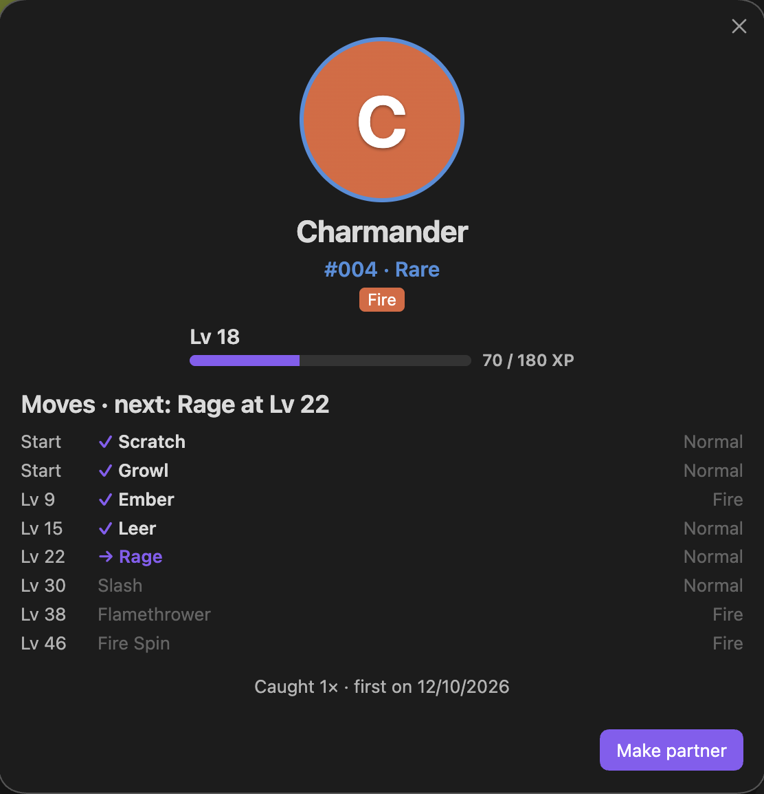
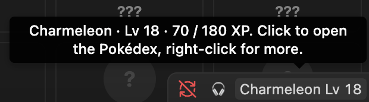
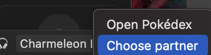
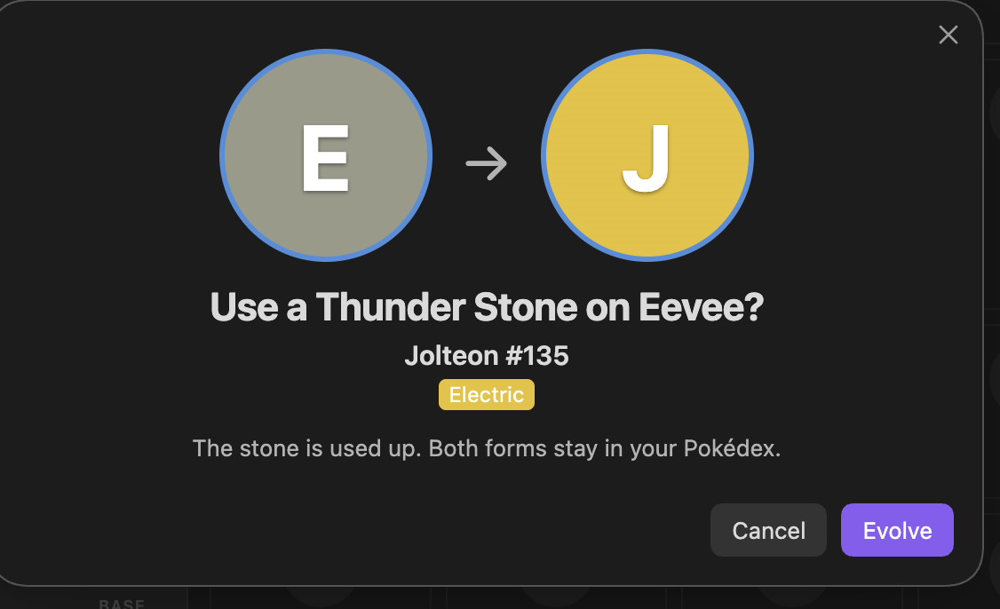
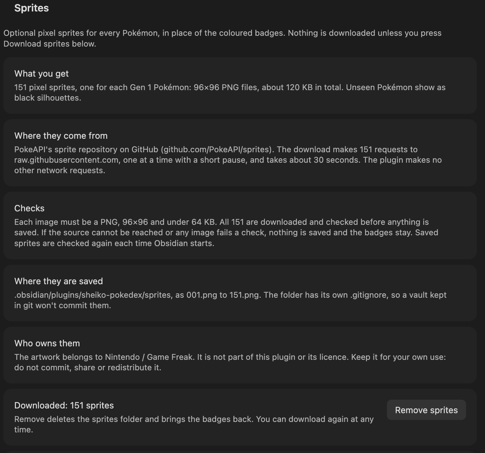

# Sheiko Pokédex: user guide

A walk-through of what you'll see, from your first close to your first evolution. For the rules behind each step (odds, XP, limits), see the [README](../README.md).

> **About the screenshots:** they show the default **placeholder badges**, the coloured circle with a letter that every Pokémon is drawn as until you choose to download sprites. With sprites downloaded, the same screens show pixel art instead. This repository contains no Pokémon artwork, screenshots included.

## Contents

1. [Install and enable](#1-install-and-enable)
2. [Close a task, catch a Pokémon](#2-close-a-task-catch-a-pokémon)
3. [The Pokédex view](#3-the-pokédex-view)
4. [A Pokémon's details](#4-a-pokémons-details)
5. [Your partner in the status bar](#5-your-partner-in-the-status-bar)
6. [Evolution](#6-evolution)
7. [Sprites (optional)](#7-sprites-optional)
8. [Starter pack (once)](#8-starter-pack-once)

## 1. Install and enable

You need Obsidian desktop with [TaskNotes](https://github.com/callumalpass/tasknotes) and [Sheiko Task Lifecycle](https://github.com/Ashura-Sheikh/Sheiko-obsidian-plugin) enabled. Follow [Install](../README.md#install) in the README, then turn on **Sheiko Pokédex** in **Settings → Community plugins**.

If either required plugin is missing, a notice tells you, and closes won't earn Pokémon until it's enabled.

<!-- screenshot needed: Settings → Community plugins, Sheiko Pokédex enabled, showing the current version -->

## 2. Close a task, catch a Pokémon

Close tasks in TaskNotes as you normally do. While Obsidian is running, each counted close shows a short notice:

> Sheiko Pokédex: close 3 toward your next catch

The number of closes needed is hidden and changes after every catch (somewhere from 4 to 7). When you reach it, the **reward window** opens:

- the task that triggered the catch ("Closed: …")
- the Pokémon, its number, its rarity (Common, Uncommon, Rare or Legendary) and its types
- why you got that rarity: how many closes were in the batch, their average score, any daily boost, and the final score out of 8
- your partner's XP, and "grew to Lv …!" or "Learned …!" when it levels up
- "You found a … Stone!" when the catch also finds a stone
- **Open Pokédex** or **Nice**

Prefer something quieter? Turn off **Show reward window** in the plugin's settings to get a short notice instead.

<!-- screenshot needed: the reward window after a catch, current version (score out of 8, XP line) -->

## 3. The Pokédex view

Open it from the ribbon icon (**Open Pokédex**), from the **Open Pokédex** command, or with **Open Pokédex** in the reward window.

- **Partner card** at the top: your partner with its level and XP bar, its current moves, its next move and what it evolves into. **Details** opens its full page; **Change partner** picks another.
- **Stats:** species caught out of 151, total catches, catches and closes today, progress toward the next catch, and how many of each rarity you've caught.
- **The grid:** all 151 Gen 1 Pokémon. The ones you've caught show their name, level, types and the 4 moves they know. The rest show as **???**.

You won't have a partner at first. Choose one with **Choose partner** in the view, the **Choose partner** command, or **Make partner** on any Pokémon you've caught. Only your partner earns XP.

<!-- screenshot needed: the Pokédex view in badge mode, partner card, stats row and part of the grid -->

## 4. A Pokémon's details

Click any Pokémon you've caught to open its details.

- Its number, rarity, types, level and XP.
- **Moves:** the full Red/Blue list with the level each is learned at. ✓ marks the 4 it knows now, faded moves are ones it has outgrown, and → marks the next one.
- How many times you've caught it, and when you first did.
- **Make partner** (or **Partner**, if it already is).
- A button for each stone that would evolve it, with how many of that stone you have.

## 5. Your partner in the status bar

Your partner sits in Obsidian's status bar, for example "Charmeleon Lv 18".

- **Hover** to see its XP, and whether an evolution is waiting.
- **Click** to open the Pokédex, or to choose a partner if you haven't yet.
- **Right-click** for a short menu: **Open Pokédex**, **Choose partner** and, once your partner has reached its evolution level, **Evolve now**.

## 6. Evolution

**By level.** When your partner reaches its evolution level, the **Game Boy evolution scene** starts straight away: "What? CHARMELEON is evolving!" on a green screen, with the old and new forms flickering in Red/Blue's own timing.

- To stop it, press **B**, press **Stop**, or close the window. You'll be asked again at the next level, or any time with **Evolve now** in the status-bar menu.
- If you let it finish, the evolved form takes over as your partner, keeping its level.
- **Both forms stay caught** in your Pokédex.
- **Calm evolution scene** in the settings replaces the flicker with a slow fade. It's also used automatically when your system asks for reduced motion.

<!-- screenshot needed: the Game Boy evolution scene in badge mode -->

**By stone.** Some Pokémon evolve with a stone instead. Stones are found now and then with a catch. To use one, open the Pokémon's details and press the stone's button. You'll be asked to confirm first:

Press **Evolve** and the same Game Boy scene plays. As in the game, a stone evolution can't be stopped once it starts. The stone is used up, and both forms stay in your Pokédex.

## 7. Sprites (optional)

Out of the box, every Pokémon is a placeholder badge, and the plugin makes no network requests. To see the classic pixel sprites instead, go to **Settings → Sheiko Pokédex → Sprites** and press **Download sprites**.

The settings explain each part before you press anything:

- **What you get:** 151 pixel sprites, about 120 KB in total.
- **Where they come from:** PokeAPI's sprite repository on GitHub. It's 151 requests, one at a time, and takes about 30 seconds.
- **Checks:** every image is checked before anything is saved. If anything fails, nothing is saved and the badges stay, and the settings show why.
- **Where they are saved:** in the plugin's own folder, with a `.gitignore` so a vault kept in git won't commit them.
- **Who owns them:** the artwork belongs to Nintendo / Game Freak. Keep it for your own use: don't commit, share or redistribute it.

**Remove sprites** deletes them and brings the badges back. You can download them again at any time.

## 8. Starter pack (once)

Want a head start? Every install comes with a one-time **Starter pack**. Find it in **Settings → Sheiko Pokédex → Starter pack**, or as **Starter pack: …** commands.

- **One of each stone:** a Fire, Water, Thunder, Leaf, Moon and Trade Stone.
- **Choose a Pokémon:** pick any one you haven't caught yet, legendaries included. It joins your Pokédex at level 5.
- **500 XP for your partner, 3 times:** each use goes to whoever is your partner at the time. Choose a partner first; with none, nothing is used.

Each part asks **"This can only be used once. Use it now?"** before anything happens. Once used, it's gone for good on this install: updates and reloads don't refill it. The settings show what's left, and a used-up part's command disappears.

<!-- screenshot needed: Settings → Starter pack, in badge mode -->
